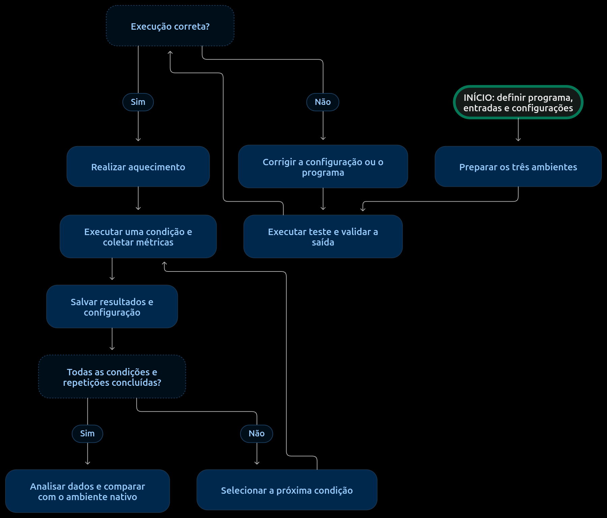

# INF0336 - Seminário

## Máquinas Virtuais x Contêineres

## Equipe: queremos emprego
202301431 - Danilo Lourenço Macedo Dias  
202301437 - Felipe do Espirito Santo Sabino  
202401773 - Gabriel dos Santos Oliveira  
202103785 - Wevton Junior Fagundes Santana

## Apresentações
1. [Apresentação 1](https://docs.google.com/presentation/d/1eixvtAASkLtC9iFD6saS6Op2AYg7gExORQ_1SO6LLiE/edit?slide=id.g1619b4b1478_0_160#slide=id.g1619b4b1478_0_160)  
2. [Apresentação 2](https://docs.google.com/presentation/d/1ICUxV39he5M6L8Q5ocgflnhrpJmuoMaQnYiOIuaaYek/edit?slide=id.h1b1034c9d852efe2_1_0#slide=id.h1b1034c9d852efe2_1_0)  

## Resumo
Máquinas virtuais e contêineres oferecem diferentes formas de isolamento de aplicações, que podem influenciar o desempenho e o consumo de recursos. Este projeto tem como objetivo comparar a execução de um mesmo programa em ambiente nativo, em um contêiner e em uma máquina virtual. Serão realizados testes repetidos sob condições controladas, utilizando o GNU Time para medir o tempo total de execução, o tempo de CPU, a utilização média de CPU e o pico de memória residente. Os resultados serão comparados com a execução nativa e discutidos com base na literatura. Espera-se identificar diferenças de desempenho e consumo de recursos entre os ambientes para a carga de trabalho escolhida. 

## Introdução

### Motivação

O interesse pelo tema surgiu inicialmente da utilização de máquinas virtuais como forma de executar diferentes sistemas operacionais em uma mesma máquina física. Essa experiência despertou a curiosidade sobre os conceitos de virtualização e sobre as diferentes maneiras de manter ambientes de execução isolados. A partir disso, surgiu o interesse pela conteinerização, uma abordagem que isola aplicações sem implementar virtualização do hardware. Com o objetivo de compreender melhor o funcionamento dessas duas tecnologias e suas diferenças práticas, optou-se por realizar uma análise comparativa de desempenho entre máquinas virtuais e contêineres, avaliando o impacto de cada abordagem sobre a utilização dos recursos computacionais.

### Revisão bibliográfica

Para compreender os fundamentos da virtualização e o funcionamento das máquinas virtuais, foi utilizado como referência o livro *Fundamentos de Sistemas Operacionais*, de Silberschatz, Galvin e Gagne. Como complemento, consultou-se a documentação oficial do Docker, que apresenta os conceitos fundamentais da conteinerização.

Além da fundamentação teórica, foram consultados trabalhos que investigam as diferenças de desempenho entre essas tecnologias. Felter et al. (2015) apresentam uma comparação entre máquinas virtuais e contêineres Linux. De maneira semelhante, Zheng et al. (2017) investigam a sobrecarga de desempenho associada à virtualização baseada em hipervisores e à baseada em contêineres. Esses trabalhos serviram de referência para compreender os fatores que podem influenciar o desempenho de cada ambiente e para orientar a análise dos resultados obtidos neste projeto.

Por fim, para auxiliar na coleta das métricas dos experimentos, foi consultada a documentação do GNU Time, que descreve o funcionamento do comando `time` e as informações que podem ser obtidas durante a execução de um programa, como o tempo de execução, o tempo de CPU e o pico de memória residente.

### Objetivos

Comparar o tempo total de execução, o tempo de CPU, a utilização média de CPU e o pico de memória residente de uma aplicação nos três ambientes. Os testes serão realizados sob condições controladas e com repetições, permitindo analisar a variabilidade dos resultados e relacioná-los à literatura.

## Metodologia

### Conjunto de dados e experimentos

Os dados serão produzidos pela equipe por meio da execução de um mesmo programa em três ambientes: nativo, contêiner e máquina virtual. Serão utilizadas entradas de diferentes tamanhos, mantendo os mesmos dados de entrada nos três ambientes. O programa e os tamanhos das entradas serão definidos na etapa de preparação.

Cada combinação de ambiente e entrada será uma condição experimental, executada repetidas vezes. Os resultados serão registrados em tabelas e analisados por meio de estatísticas descritivas, como média, mediana e desvio-padrão, permitindo comparar o desempenho e a variabilidade das medições.

### Modelos e infraestrutura

Os experimentos serão realizados em uma mesma máquina física, com Linux, utilizando execução nativa, contêiner Docker e uma máquina virtual Linux. A ferramenta de virtualização será definida e documentada durante a preparação dos ambientes.

Serão mantidas versões equivalentes do programa e de suas dependências, além do mesmo número de threads e condições comparáveis de acesso aos recursos. As configurações de hardware, software, CPU e memória serão registradas para permitir a reprodução dos testes.

Antes das medições, serão realizados testes de validação da saída e aquecimento. As execuções ocorrerão uma por vez, alternando a ordem dos ambientes e reduzindo atividades em segundo plano. O tempo de inicialização dos ambientes não fará parte das medições.

### Métricas

A coleta será realizada com o GNU Time, utilizando o comando `/usr/bin/time -v ./prog` dentro de cada ambiente. Serão consideradas as seguintes métricas:

- **Tempo total de execução:** tempo decorrido entre o início e o término do programa, incluindo processamento e esperas.
- **Tempo de CPU:** soma dos tempos de processamento em modo usuário (*User time*) e em modo kernel (*System time*).
- **Utilização média de CPU:** relação percentual entre o tempo de CPU e o tempo total de execução.
- **Pico de memória residente:** maior quantidade de memória do processo residente na RAM durante a execução.

As medições representam os recursos utilizados pela aplicação, não o consumo total da infraestrutura, como o sistema operacional da máquina virtual. Os resultados serão comparados com a execução nativa, considerando as diferenças percentuais e a variabilidade entre repetições, e discutidos com base na literatura.

## Fluxograma

## Resultados
- Gráficos
- Tabelas
- Multimídia (vídeos, imagens, áudio)

## Discussão
Análise com base na literatura utilizada na seção de Introdução!

## Conclusão
Em que medida o(s) objetivo(s) foi(foram) alcançado(s)?

## Referências

- DOCKER INC. **What is a container?** [S. l.]: Docker Inc., [s. d.]. Disponível em: https://docs.docker.com/get-started/docker-concepts/the-basics/what-is-a-container/. Acesso em: 4 nov. 2026.

- FELTER, Wes; FERREIRA, Alexandre; RAJAMONY, Ram; RUBIO, Juan. An updated performance comparison of virtual machines and Linux containers. In: IEEE INTERNATIONAL SYMPOSIUM ON PERFORMANCE ANALYSIS OF SYSTEMS AND SOFTWARE (ISPASS), 2015, Philadelphia. **Proceedings [...]**. [S. l.]: IEEE, 2015. p. 171–172. DOI: 10.1109/ISPASS.2015.7095802. Disponível em: https://people.computing.clemson.edu/~jmarty/projects/lowLatencyNetworking/papers/TGIF-middleware/AnupdatedPerfAnalysisofContainersandVMs.pdf. Acesso em: 4 nov. 2026.

- GNU PROJECT. **GNU Time**. [S. l.]: GNU Project, [s. d.]. Disponível em: https://www.gnu.org/software/time/manual/time.html. Acesso em: 4 nov. 2026.

- LI, Zheng; KIHL, Maria; LU, Qinghua; ANDERSSON, Jens A. Performance overhead comparison between hypervisor and container based virtualization. In: IEEE INTERNATIONAL CONFERENCE ON ADVANCED INFORMATION NETWORKING AND APPLICATIONS (AINA), 31., 2017, Taipei. **Proceedings [...]**. [S. l.]: IEEE, 2017. p. 955–962. DOI: 10.1109/AINA.2017.79. Disponível em: https://arxiv.org/pdf/1708.01388. Acesso em: 4 nov. 2026.

- SILBERSCHATZ, A.; GALVIN, P.; GAGNE, G. **Fundamentos de sistemas operacionais**. 8. ed. Rio de Janeiro: LTC, 2010.
